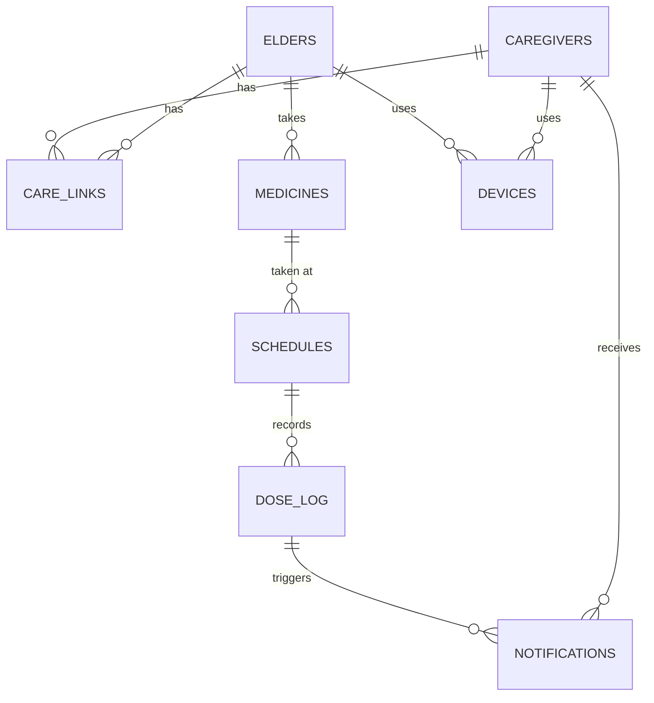

# GoldenDose — Data Design

*Step 4 of 10: decide what the database stores and how it's organised.*

## The idea in one paragraph

A database is a set of **tables**, like sheets in a spreadsheet. Each table holds one kind
of thing (people, medicines, doses). Each **row** is one item, and each **column** is one
fact about it. Every row has an **id**, a number that never changes and is never reused,
so other tables can point to it. A column that points to another table's id is called a
**foreign key**. That's how tables link together.

## The 8 tables

### 1. `caregivers` — people who sign in to manage medicines (Priya, her brother)

| Column | Example | Notes |
|---|---|---|
| id | 1 | |
| name | Priya Sharma | |
| phone | +91 98xxxxxx10 | For SMS and WhatsApp messages |
| email | priya@example.com | For signing in |
| password_hash | (scrambled text) | We **never** store the real password. See note below. |
| created_at | 2026-10-12 10:30 | |

> **Why "password_hash"?** The password is put through a one-way scrambler before it is saved.
> When Priya signs in, we scramble what she typed and compare the two scrambles. If the
> database were ever stolen, the thief would get scrambles, not passwords.

### 2. `elders` — the people taking medicine (Kamala)

| Column | Example | Notes |
|---|---|---|
| id | 1 | |
| name | Kamala | Shown in "Good morning, Kamala" |
| timezone | Asia/Kolkata | So "9:00 am" means 9:00 where *she* lives |
| created_at | 2026-10-12 10:35 | |

> **No password for elders.** Kamala never signs in. Instead, Priya shows a 6-digit
> **pairing code** once, it's entered on Kamala's phone, and that phone is remembered.
> (See `devices`.) This removes the hardest step for older users.

### 3. `care_links` — who looks after whom (the many-to-many table)

| Column | Example | Notes |
|---|---|---|
| id | 1 | |
| caregiver_id | 1 → Priya | Foreign key to `caregivers` |
| elder_id | 1 → Kamala | Foreign key to `elders` |
| role | owner | `owner` can invite others; `helper` can view and edit |
| notify_sms | yes | How *this* caregiver wants to hear about *this* elder |
| notify_whatsapp | no | |
| notify_app | yes | |

> **This is the answer to your two "yes" questions.** A caregiver can't have a single
> "elder" column (she might look after two), and an elder can't have a single "caregiver"
> column (she might have two). So we add a table in the middle where each row is one link.
>
> | caregiver | elder |
> |---|---|
> | Priya | Kamala |
> | Priya | Ramesh (her father) |
> | Arjun (her brother) | Kamala |
>
> Professionals call this a **join table**. It's one of the most common patterns in databases.

### 4. `medicines` — what each elder takes

| Column | Example | Notes |
|---|---|---|
| id | 2 | |
| elder_id | 1 → Kamala | |
| name | Amlodipine | |
| strength | 5 mg | |
| instruction | Take one pink tablet | Read aloud by the app |
| pill_shape | oval | round / oval / capsule |
| pill_color | #F4A7B9 | For the drawing when there's no photo |
| photo_url | /photos/2.jpg | The caregiver's photo of the strip |
| active | yes | Set to "no" when a medicine is stopped. We keep the row so history still makes sense. |

### 5. `schedules` — when each medicine is taken

| Column | Example | Notes |
|---|---|---|
| id | 4 | |
| medicine_id | 1 → Metformin | |
| time_of_day | 20:00 | |

> **Why a separate table?** Metformin is taken twice a day, at 8:00 and 20:00. One medicine,
> many times. Putting times in their own table means one row per time, however many there are.
> This is a **one-to-many** relationship.

### 6. `dose_log` — what actually happened (the most important table)

| Column | Example | Notes |
|---|---|---|
| id | 57 | |
| schedule_id | 2 → Amlodipine at 9:00 | |
| date | 2026-10-12 | |
| status | taken | `taken`, `skipped` or `missed` |
| recorded_at | 2026-10-12 09:02 | When the button was pressed |
| recorded_by | elder | `elder`, `caregiver` or `system` (the missed-dose check) |

> **A rule the database enforces itself:** there can only be **one row per schedule per day**.
> This makes double-counting impossible. Even if Kamala taps "Taken" twice on two phones,
> the database refuses the second one. It's called a **unique constraint**.
>
> **Undo** deletes the row (only allowed within 5 minutes; the backend checks).
> **Taking a dose late** changes `missed` to `taken`.

### 7. `devices` — phones that are signed in

| Column | Example | Notes |
|---|---|---|
| id | 3 | |
| elder_id *or* caregiver_id | elder 1 | Whose phone it is |
| platform | android | `web`, `android` or `ios` |
| push_token | (long code) | The "address" for sending app notifications to this phone |
| last_seen | 2026-10-12 09:02 | |

### 8. `notifications` — every message sent to a caregiver

| Column | Example | Notes |
|---|---|---|
| id | 12 | |
| dose_log_id | 58 → Vitamin D missed | |
| caregiver_id | 1 → Priya | |
| channel | whatsapp | `sms`, `whatsapp` or `app` |
| status | sent | `sent` or `failed` |
| sent_at | 2026-10-12 13:30 | |

> **Why keep this?** For a health app it matters to be able to answer
> "Was Priya actually told?" If a message fails, we can see it and retry.

## How the tables connect

Read `||--o{` as "one ... to many". For example, one elder takes many medicines.

## Extra columns added while building (Step 6)

Building the real thing always uncovers details. These were added in `backend/src/schema.sql`:

| Table | Column | Why |
|---|---|---|
| `elders` | `pairing_code`, `pairing_code_expires_at` | Store the 6-digit code for 10 minutes |
| `schedules` | `active`, `created_at` | A removed time is switched off, not deleted (past doses point to it). And a medicine added at 3 pm with an 8 am time isn't "missed" that day |
| `devices` | `token_hash` | The scrambled sign-in token, checked on every request |
| `notifications` | `message`; status `simulated` | Keep the exact words sent. "Simulated" until real SMS/WhatsApp sending in Step 9 |

## Which database software?

- **While building (Steps 6–8): SQLite.** The whole database is a single file in our project
  folder. Nothing to install or pay for, which makes it ideal for learning.
- **When the app goes online (Step 9): PostgreSQL.** The industry standard for real apps with
  many users at once. It understands the same SQL language, so the move is small.
